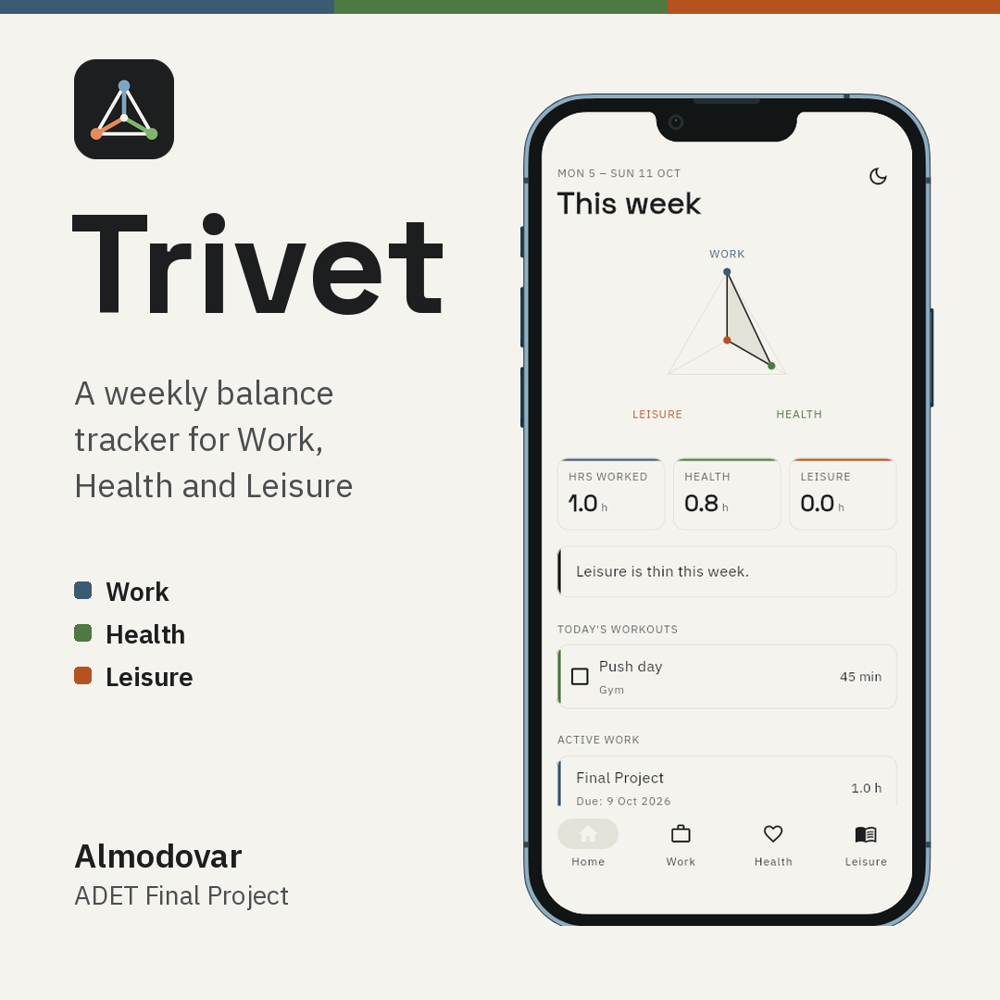

# Final Project

## My project repository

Public repository: https://github.com/Keonzane/Trivet

Live app (if deployed): https://keonzane.github.io/Trivet/

## What it is

Trivet is a Flutter app for students and early-career workers that tracks
how many hours went into Work, Health and Leisure this week and shows them
side by side, so you can see when one area is crowding out the others.

## How to run it

The quickest way is the live app above: it runs in the browser with
nothing to install. To run it from the code:

1. Install Flutter (stable channel, Dart 3.3 or newer) by following
   https://docs.flutter.dev/get-started/install, then check the setup with:

   ```
   flutter doctor
   ```

2. Get the code:

   ```
   git clone https://github.com/Keonzane/Trivet.git
   cd Trivet
   ```

3. Install the dependencies:

   ```
   flutter pub get
   ```

4. Run the app in Chrome (or pick a connected phone or emulator with
   `flutter devices` and `flutter run -d <device-id>`):

   ```
   flutter run -d chrome --dart-define-from-file=dart_defines.json
   ```

   On Windows, `run.bat -d chrome` runs the same command.
   `dart_defines.json` holds the address of the search proxy, so film, TV
   and game search work. Without that part the app still runs, but only
   book and anime search are on. No API keys are needed: they stay on the
   proxy. All entries are saved on the device.

   The first launch needs an internet connection, because the app
   downloads its two fonts from Google Fonts. In the browser, including
   the live app, it opens inside a phone frame (Device Preview), so it is
   shown at phone size instead of stretched across the window.

The project's documents (proposal, wireframes and mockup, design system,
weekly reports, demo video and the security checklist) are in the
repository's `docs/` folder:
https://github.com/Keonzane/Trivet/tree/main/docs

## Presentation

- Video (public Google Drive link): https://...
- Slides (PDF): [`trivet-slides.pdf`](trivet-slides.pdf) in this folder
- Square image: [`trivet-square.png`](trivet-square.png) in this folder

  

- Logo: [`trivet-logo.png`](trivet-logo.png) in this folder

   

## AI usage

Link to the `AI-USAGE.md` in my project repository:
https://github.com/Keonzane/Trivet/blob/main/AI-USAGE.md
