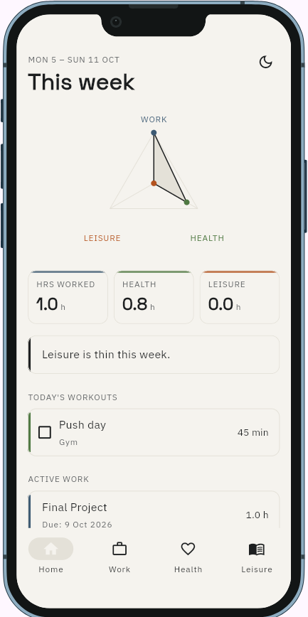
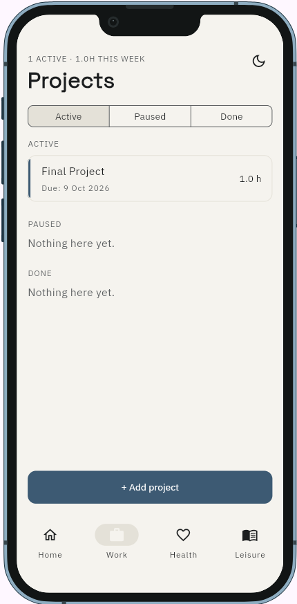
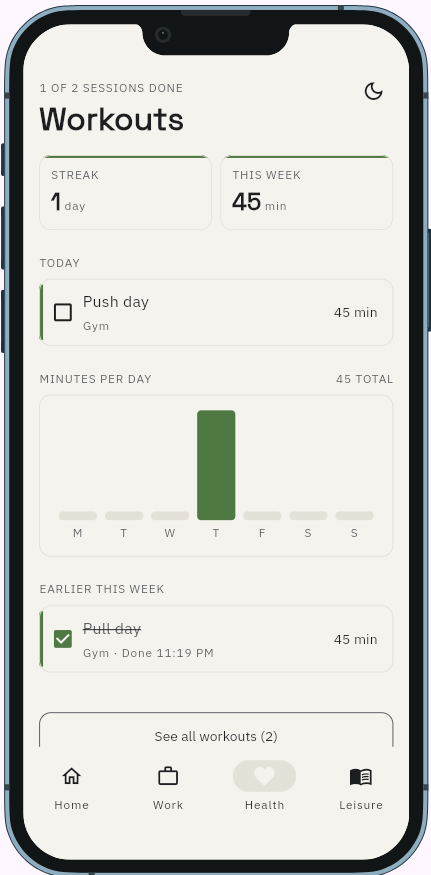
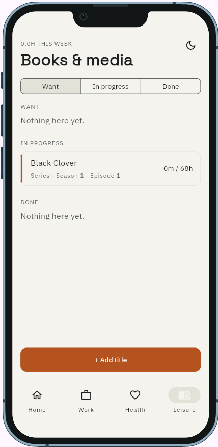
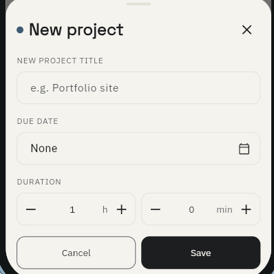
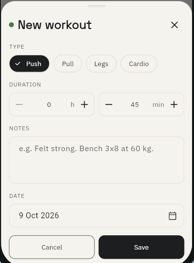
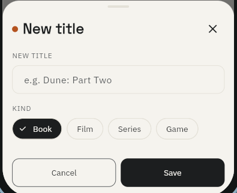

# Trivet

> A weekly balance tracker for university students and early-career
> workers: it shows how many hours went into Work, Health and Leisure this
> week, side by side, so you can see when one is crowding out the others.

**Live demo:** https://keonzane.github.io/Trivet/  
**Demo video:** see [docs/05-demo-video.md](docs/05-demo-video.md)  
**Course:** Applications Development and Emerging Technologies (6ADET), Holy Angel University  
**Author:** Almodovar

This repository is in my own GitHub account and is public on purpose.
There is no `student.json` here and there should not be one. See
[docs/06-security-and-privacy.md](docs/06-security-and-privacy.md) for what
that means for secrets and personal data.

---

## Screenshots

| Home (Dashboard) | Work |
| --- | --- |
|  |  |

| Health | Leisure |
| --- | --- |
|  |  |

| New project | New workout | New title |
| --- | --- | --- |
|  |  |  |

## What it does

- Log hours against work projects, with a status, due date and notes.
- Plan and tick off workouts (Push, Pull, Legs, Cardio), with a streak and
  a bar chart of minutes per day.
- Keep a shelf of books, films, series and games, found by searching TMDB,
  RAWG, Open Library and AniList, and track progress, ratings and reviews.
- See the week on the Dashboard: a triangle chart comparing the three
  pillars, this week's hours per pillar, and a nudge naming the thinnest
  one.
- Everything is saved on the device. Light and dark mode.

### In more detail

**Home (Dashboard)** shows the week's date range, the triad chart
comparing the three pillars, a stat card per pillar with this week's
hours, and a one-line nudge naming the thinnest pillar. Below that:
today's workouts (tick them off here), active work projects, and
"Currently enjoying" (titles in progress, plus ones finished this week)
with **SEE ALL** jumping to Leisure. `+ Log entry` opens the Add entry
sheet with a Work / Health / Leisure picker.

**Work** lists projects in one scrolling page with Active / Paused / Done
sections; the bar at the top jumps to a section and follows your
scrolling. Each card shows the due date and hours this week. `+ Add
project` creates a project (title, optional due date, optional first
hours). Tapping a project opens its detail screen: total hours, status,
due date, notes, and `+ Log hours`.

**Health** shows "X of Y sessions done", the current streak and minutes
this week (done sessions only), today's sessions as a checklist, a bar
chart of minutes per day, upcoming sessions and earlier ones this week.
`+ Log workout` adds a Push, Pull, Legs or Cardio session with duration,
date and notes. Ticking a session records when it was done. `See all
workouts` lists every session grouped by date.

**Leisure** lists titles in Want / In progress / Done sections on one
page. `+ Add title` asks for a title and kind (Book, Film, Series, Game);
typing a title shows search results, and picking one fills in the title
and its totals (pages, runtime, seasons and episodes). Tapping a title
opens its detail screen, which changes with the status:

- **Want:** notes.
- **In progress:** current page for books, where you stopped for films,
  season and episode plus where you stopped for series, and time played
  for games. Progress can't go past the totals. Each change is logged as
  leisure time for that day.
- **Done:** a 1–5 star rating and a review, separate from the notes.

Leisure time only counts toward the week once a title is started, so
titles still in Want don't add hours.

Every list supports swipe-left-to-delete. A "Deleted" message with an
**Undo** button appears for 5 seconds; Undo puts the item back, together
with its logged hours or time. After 5 seconds the delete is final.

## Built with

| | |
| --- | --- |
| Framework | Flutter (Dart SDK `>=3.3.0 <4.0.0`), Material 3 |
| State | `StatefulWidget` and `setState`, one screen at a time; no state management package |
| Storage | `shared_preferences`, one key per model, through a generic `ListStore<T>` |
| Other packages | `google_fonts` (Space Grotesk and IBM Plex Sans), `http` (leisure search), `url_launcher` (the TMDB and RAWG credit links), `device_preview` (the phone frame in the browser) |
| Search proxy | a Cloudflare Worker in `media_proxy/` that holds the TMDB and RAWG keys |
| Deploy | GitHub Actions (`.github/workflows/deploy.yml`) to GitHub Pages, plus an APK |

### Project structure

```
lib/
  main.dart                  # start-up, theme switching, the 4-tab shell
  theme.dart                 # Pillar enum, AppSpacing, PillarColors,
                              # light and dark themes, fonts
  models/                    # Project, WorkLog, Workout, MediaEntry,
                              # LeisureLog, MediaResult (a search result)
  services/
    storage_service.dart     # ListStore<T> (shared_preferences),
                              # WeekRange and weekly totals
    theme_controller.dart    # saves light/dark mode
    media_search/            # MediaSearchService + one provider per API
                              # (TMDB, RAWG, Open Library, AniList)
  widgets/                   # shared cards, steppers, fields, charts,
                              # the Add entry sheet, SectionedList
  screens/                   # Dashboard, Work, Health, Leisure, and the
                              # detail and All workouts screens
media_proxy/                 # Cloudflare Worker that holds the API keys
.github/workflows/deploy.yml # builds and publishes the web app
```

State is held per screen with `StatefulWidget` and `setState`, loaded
from and saved back to the matching store. There's no state management
package.

## Running it yourself

The quickest way is the live demo: it runs in the browser with nothing to
install. To run it from the code, with Flutter on the stable channel:

```bash
flutter pub get
flutter run -d chrome --dart-define-from-file=dart_defines.json
```

or `flutter run -d web-server --web-port 8080 --dart-define-from-file=dart_defines.json`
and open http://localhost:8080. On Windows, `run.bat -d chrome` runs the
same command.

Without the `--dart-define-from-file` part the app still runs, but film, TV
and game search are off; books and anime still work. The first launch needs
an internet connection, because `google_fonts` downloads the two fonts.

In the browser, including the live site, the app opens inside a phone frame
(Device Preview), so it is shown at the size it was designed for instead of
stretched across a desktop window. On a phone it runs without the frame.

There are no automated tests yet.

The `main` branch is built and published to GitHub Pages automatically; see
[docs/deploy.md](docs/deploy.md).

### Environment variables

The app reads one value at build time, from `dart_defines.json`. It is
committed, because it holds only the address of my search proxy, which is
not secret. The format is in `dart_defines.example.json`.

| Variable | What it is | Where to get one |
| --- | --- | --- |
| `MEDIA_PROXY_URL` | the address of the Cloudflare Worker that searches TMDB and RAWG | mine is already in `dart_defines.json`; to run your own, see [docs/media-search-setup.md](docs/media-search-setup.md) |

The API keys (`TMDB_API_KEY`, `RAWG_API_KEY`) are never in the app or this
repository. They are Cloudflare secrets on the Worker.

## Privacy and secrets

- Everything a person logs (projects, hours, workouts, titles, ratings,
  notes) is stored only on their device with `shared_preferences`. There
  are no accounts, and nothing they log leaves the device. Leisure search
  sends only the typed title to the search services.
- The TMDB and RAWG keys live only in Cloudflare as Worker secrets; the
  deploy workflow reads the proxy URL from a repository secret. The built
  app contains no key.
- The app has no sample data, and the screenshots and video contain no real
  personal information.

## Project documentation

| Document | |
| --- | --- |
| [Proposal](docs/01-proposal.md) | the problem, the users, the scope |
| [Mockup and wireframes](docs/02-mockup.md) | what it looks like, and the screen flow |
| [Design system](docs/03-design-system.md) | colours, type, spacing, components |
| [Weekly reports](docs/04-weekly-reports.md) | what happened each week |
| [Demo video](docs/05-demo-video.md) | the recording and what it shows |
| [Security and privacy](docs/06-security-and-privacy.md) | the checklist, filled in |
| [Deploying](docs/deploy.md) | how GitHub builds and publishes the app |
| [Leisure search setup](docs/media-search-setup.md) | running your own search proxy |

## Status and what is next

Everything in the MVP works, plus the triad chart (stretch 1) and leisure
search. The routine builder (stretch 2) was not built.

- **Leisure time is recorded on the day you update progress**, not the
  day you actually read or watched. Changing progress on Monday for
  something watched on Sunday counts on Monday.
- **The pillar picker only appears when adding from the Dashboard.** From
  Work, Health or Leisure the sheet is already set to that pillar.
- **Tabs reload when you switch to them.** Only the open tab is built, so
  data is always fresh, but a scroll position resets when you leave a tab.
- **Delete is swipe-only**, which is easy to miss if you don't know the
  gesture.
- **The theme button can't go back to "follow the system"** once you've
  picked light or dark.
- **Film, TV and game search depend on the proxy.** If the Worker is down
  or its free limits run out, those searches return nothing; you can
  still type a title by hand.
- **Book search depends on Open Library.** If openlibrary.org is
  unreachable (down, or blocked on some networks), Book search only shows
  AniList manga results.
- **No desktop layout.** On wide screens only the navigation moves to a
  side rail; the screens keep their phone layout instead of the grids in
  my wireframes.
- **No automated tests yet.**

Next, I would add weekly goals per pillar shown as progress on the stat
cards, a look back at previous weeks on the Dashboard, tests for the
week-range logic, a "follow system" theme option, and Google Books as a
backup when Open Library is down.

## Credits

- Packages: see `pubspec.yaml`.
- Fonts: Space Grotesk and IBM Plex Sans (SIL Open Font License), through
  `google_fonts`.
- This product uses the TMDB API but is not endorsed or certified by TMDB.
  Game data from RAWG (https://rawg.io). Book data from Open Library.
  Anime and manga data from AniList.

## AI use

[](AI-USAGE.md)

Built with heavy help from Claude (Anthropic): Claude wrote most of the
code in `lib/`, while I designed the app and wrote the leisure media
search, the rating in search suggestions and the poster on the detail
screen. See [AI-USAGE.md](AI-USAGE.md) for exactly what I asked for, what I
kept or changed, and where the AI got it wrong.

## Licence

MIT, see [LICENSE](LICENSE).
