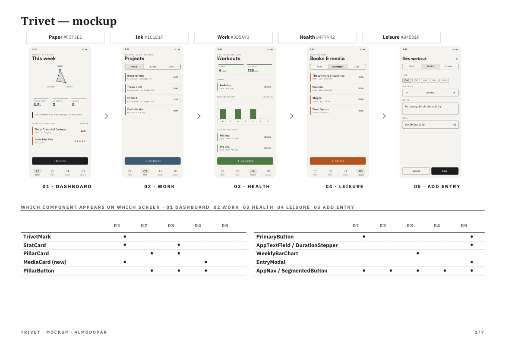
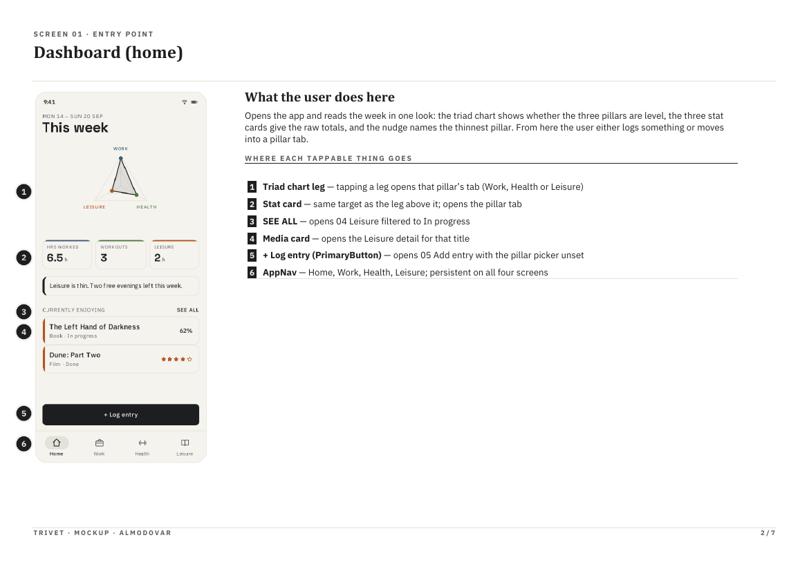
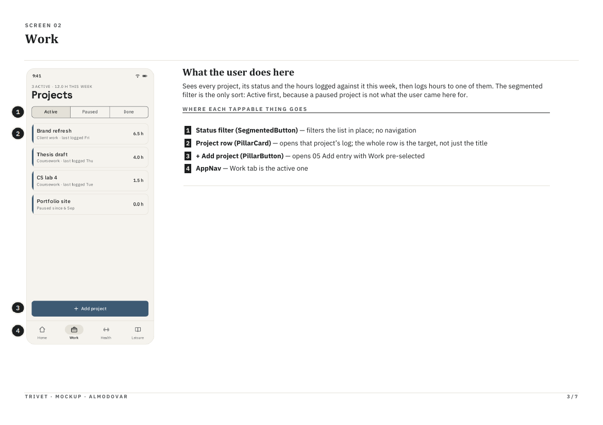
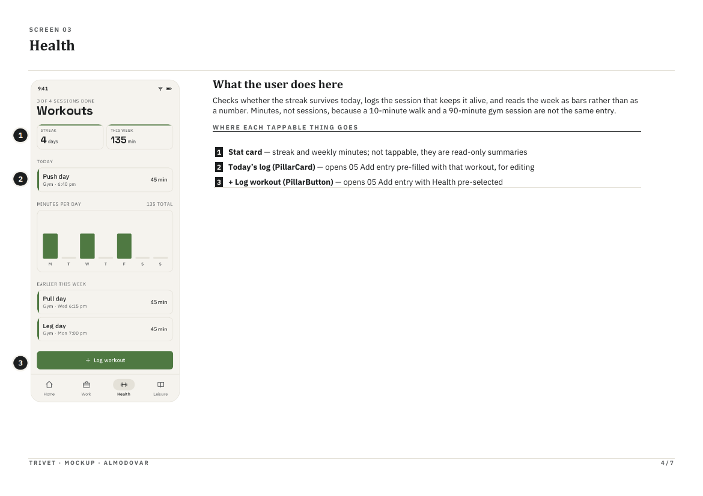
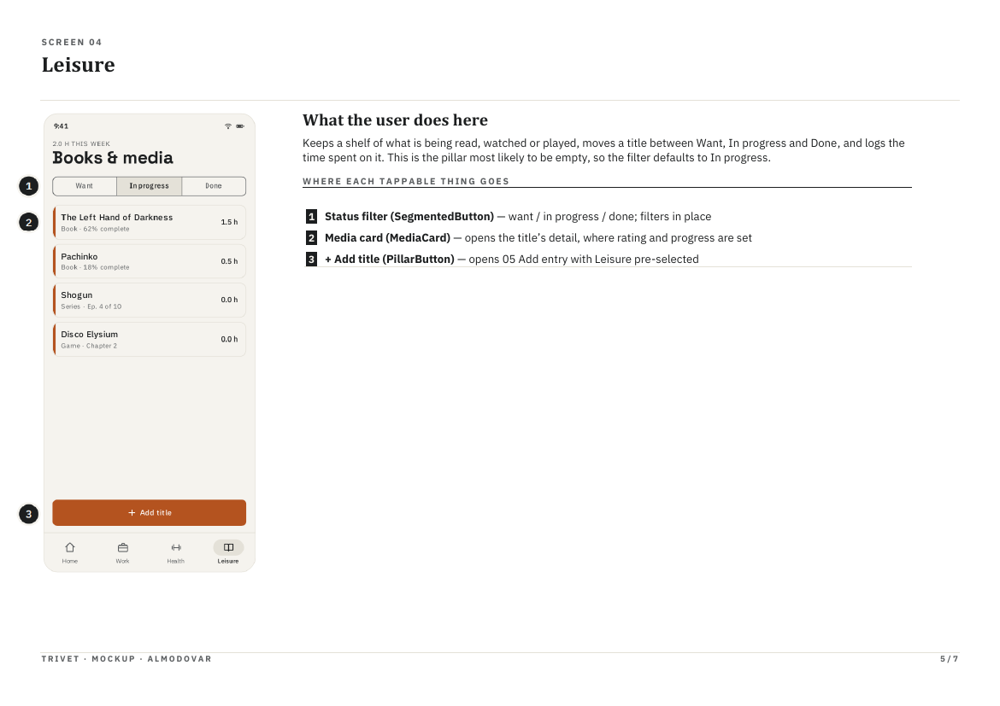
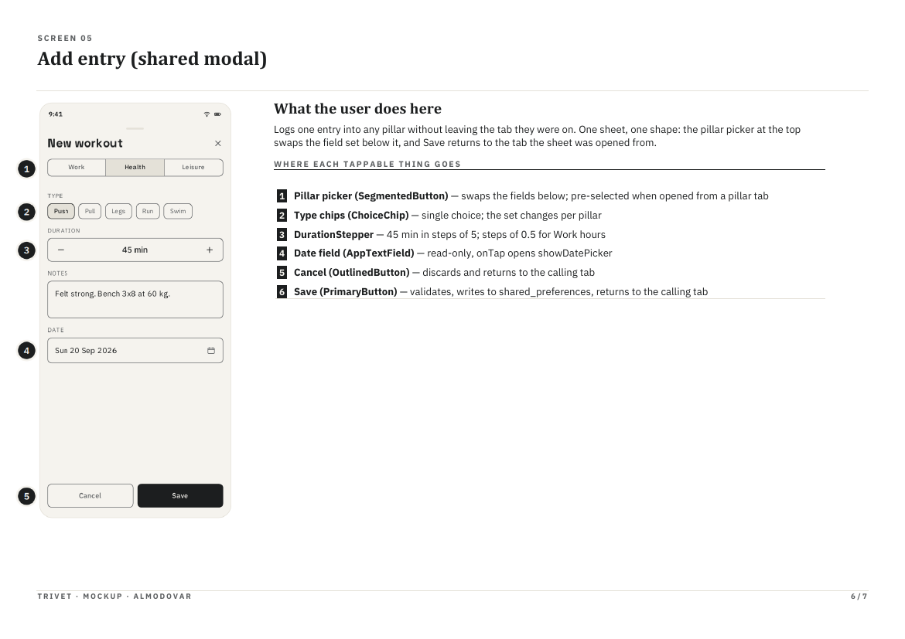
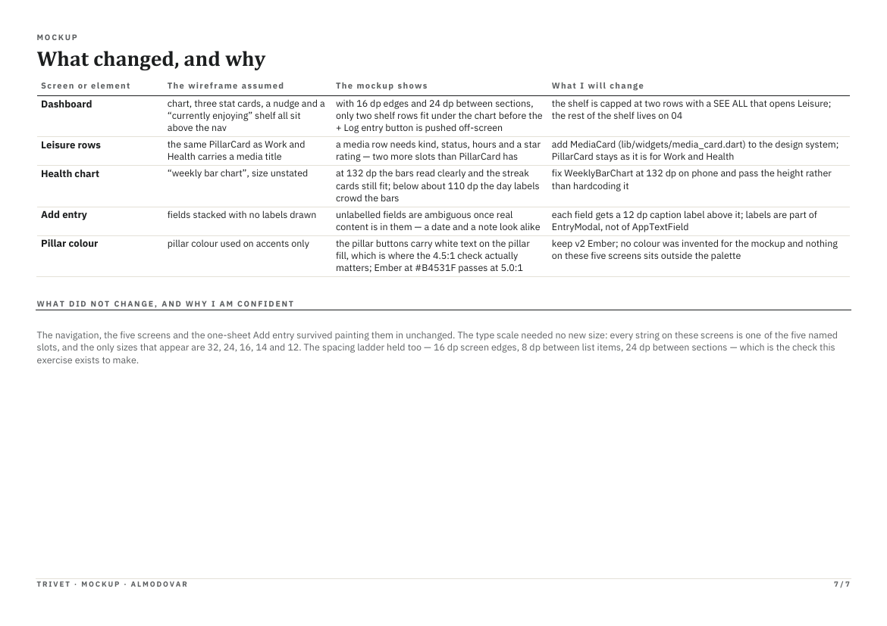
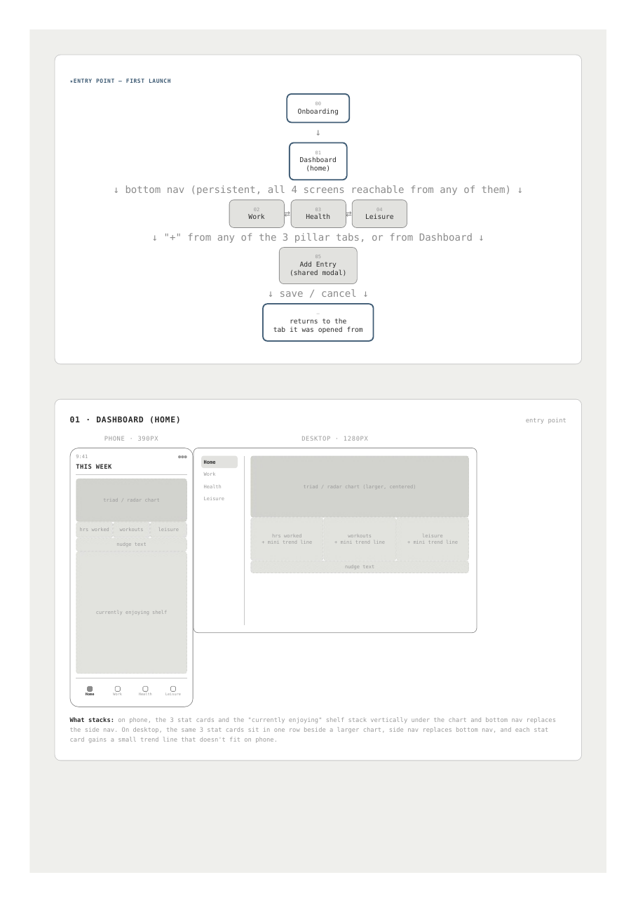
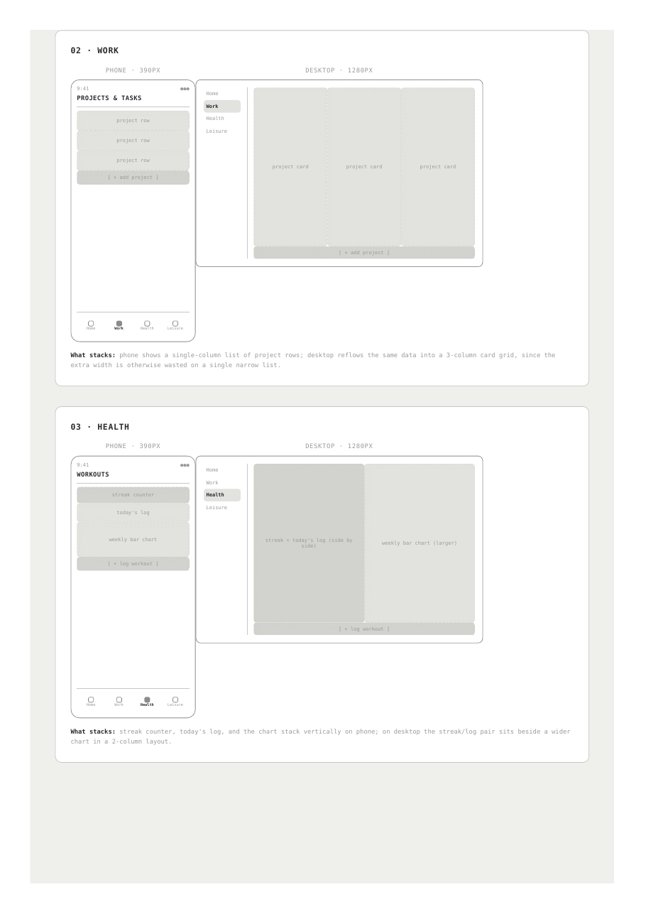
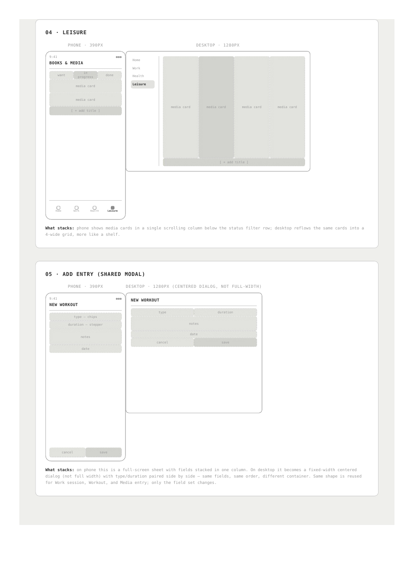

# Mockup and wireframes

The visual plan for Trivet. The full mockup is in
[assets/mockup.pdf](assets/mockup.pdf); its pages are shown below.

## Mockup

### Overview: all five screens and which component appears where



### 01 Dashboard (home)



### 02 Work



### 03 Health



### 04 Leisure



### 05 Add entry (shared sheet)



### What changed between the wireframe and the mockup



## Wireframes

My wireframes came before the mockup and set the screen flow and the phone
and desktop layouts. The PDF is in
[assets/wireframe.pdf](assets/wireframe.pdf).







### What the app does differently from the wireframes

- **No onboarding screen (00).** It was not built; the app opens straight
  on the Dashboard, and an empty list shows a short message instead.
- **Desktop layouts are not built.** The wireframes reflow Work into a
  3-column grid, Leisure into a 4-wide shelf, Health into two columns, and
  Add entry into a centred dialog on wide screens. In the app, only the
  navigation changes (a side rail at 900 dp and wider); the screens keep
  their phone layout, and in the browser the app is shown inside a phone
  frame.
- **No trend lines on the stat cards.** The wireframe gave each desktop stat
  card a mini trend line; the app shows the totals only.
- **The flow held.** Dashboard first, four tabs reachable from any of them,
  `+` from each tab or the Dashboard opening one shared Add entry sheet, and
  save or cancel returning to the tab it came from: all as built.

### The screen flow, as built

```
App opens on Home (Dashboard)
│
├── AppNav (bottom bar on a phone, side rail at 900 dp and wider)
│     Home ─ Work ─ Health ─ Leisure
│
├── Home
│     workout row ────────────────── tick done, or edit in the Add entry sheet
│     project card ───────────────── project detail
│     SEE ALL ────────────────────── opens Leisure
│     media card ─────────────────── opens the media detail screen
│     + Log entry ────────────────── Add entry sheet, pillar picker unset
│
├── Work
│     project card ───────────────── project detail (status, due date, notes, + Log hours)
│     + Add project ──────────────── Add entry sheet, Work
│
├── Health
│     workout row ────────────────── tick done, or edit in the Add entry sheet
│     See all workouts ───────────── All workouts screen
│     + Log workout ──────────────── Add entry sheet, Health
│
└── Leisure
      media card ─────────────────── media detail (changes with Want / In progress / Done)
      + Add title ────────────────── Add entry sheet, Leisure, with search
```

Swiping a row left on any list deletes it, with a 5-second Undo.

## Screens

**Home (Dashboard).** The week's date range, the triad chart comparing the
three pillars, a stat card per pillar with this week's hours, and a nudge
naming the thinnest pillar. Below: today's workouts, active projects and
"Currently enjoying". The user reads the week at a glance, then opens an
entry or logs something with `+ Log entry`. In the mockup, tapping a chart
leg or stat card opened that pillar's tab; in the app they are read-only and
the tabs are reached from the nav bar.

**Work.** Projects in Active, Paused and Done sections on one scrolling page;
the bar at the top jumps between sections. Each card shows the due date and
this week's hours. Tapping a project opens its detail screen; `+ Add
project` opens the Add entry sheet.

**Health.** "X of Y sessions done", the streak, minutes this week, today's
sessions as a checklist, a bar chart of minutes per day, upcoming and
earlier sessions. `+ Log workout` adds a session; `See all workouts` lists
every session by date.

**Leisure.** Titles in Want, In progress and Done sections. `+ Add title`
opens the sheet with search; tapping a title opens its detail screen, where
progress, rating and review are set depending on the status.

**Add entry (shared sheet).** One sheet for all three pillars. From Home it
shows a Work / Health / Leisure picker; from a pillar's own tab it is
already set to that pillar. Save validates, stores the entry and returns to
the tab it was opened from.

**Detail screens.** Project detail, media detail and All workouts were not
in the mockup. They were added once the list screens needed somewhere to
edit an entry, and they reuse the same components.
