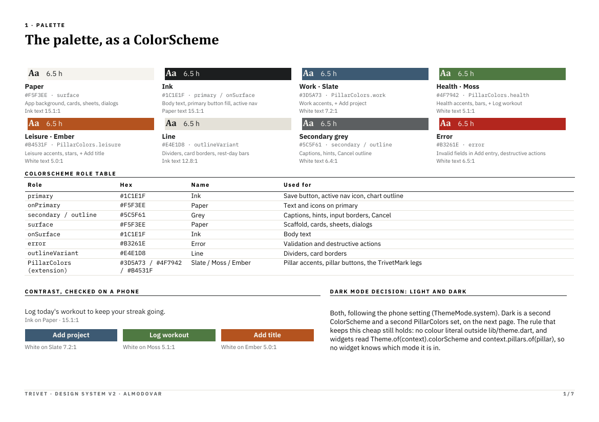
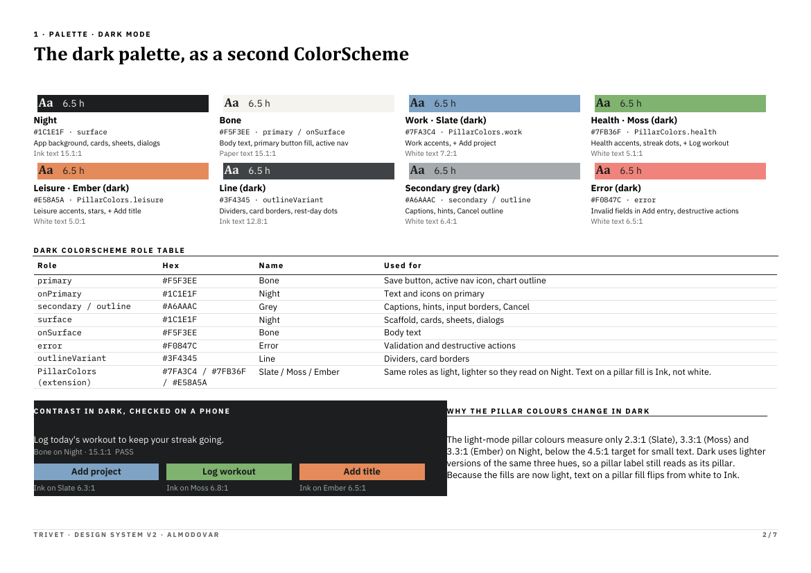
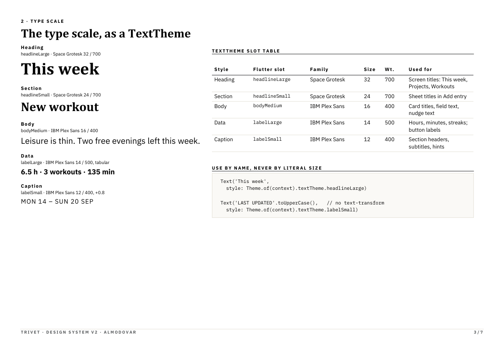
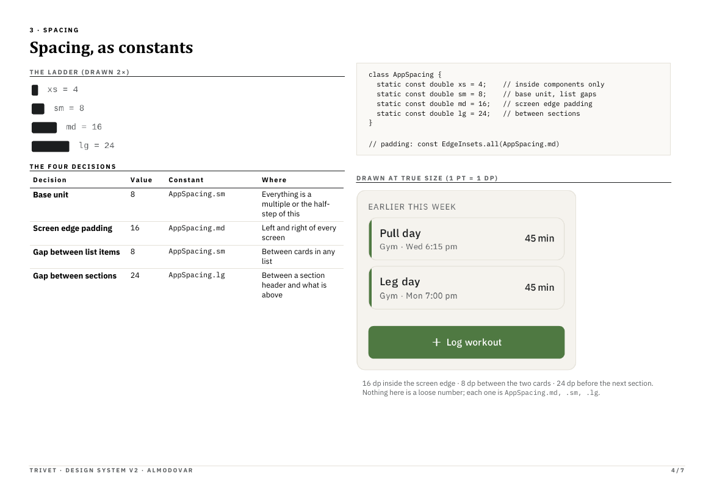
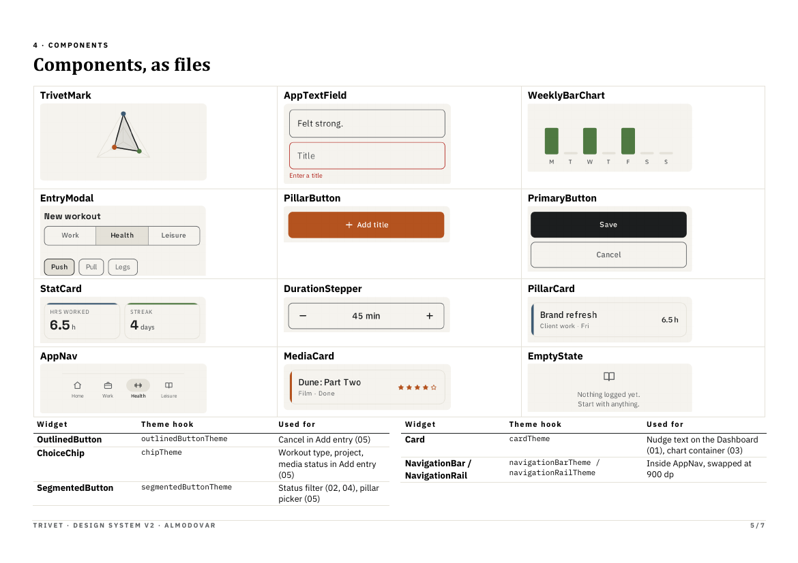
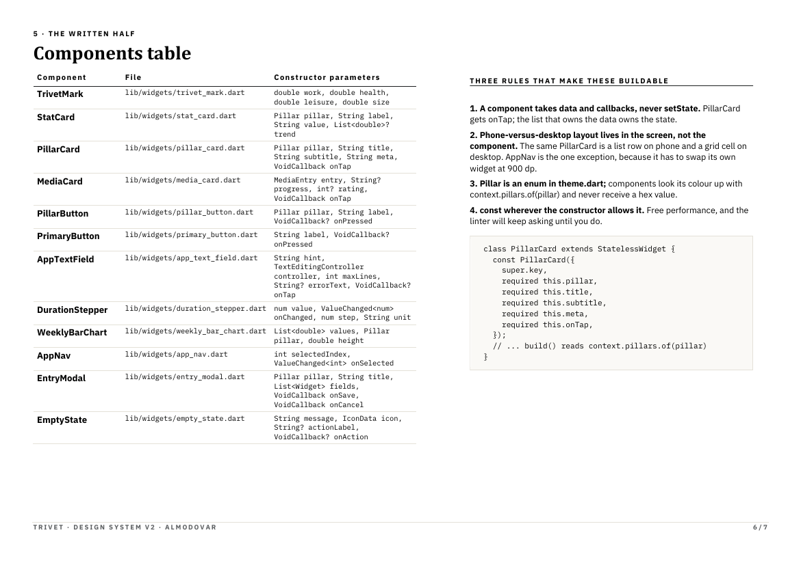
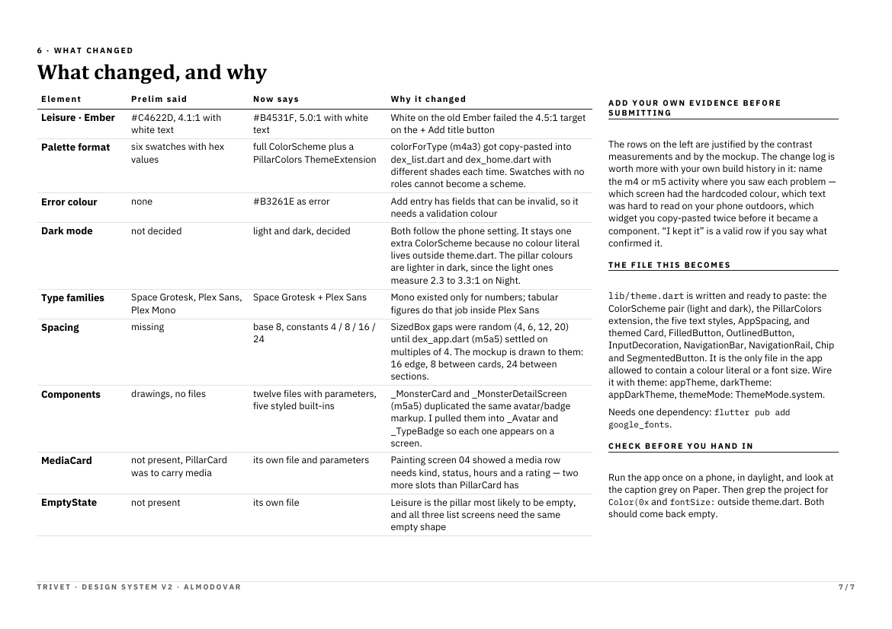

# Design system

Design System v2, as submitted, and what changed while building it. All of
it lives in code in `lib/theme.dart`, which is the only file in the app with
colour values or font sizes in it.

[Design system (PDF)](assets/design-system.pdf)

All seven pages

## Palette

A light and a dark `ColorScheme`, plus a `PillarColors` theme extension for
the three pillar colours. The app starts by following the phone's setting;
the sun/moon button switches between light and dark.

| Role | Light | Dark | Used for |
| --- | --- | --- | --- |
| surface | Paper `#F5F3EE` | Night `#1C1E1F` | background, cards, sheets, dialogs |
| primary / onSurface | Ink `#1C1E1F` | Bone `#F5F3EE` | body text, Save button, active nav icon |
| secondary / outline | Grey `#5C5F61` | Grey `#A6AAAC` | captions, hints, input borders, Cancel |
| outlineVariant | Line `#E4E1D8` | Line `#3F4345` | dividers, card borders |
| error | `#B3261E` | `#F0847C` | invalid fields, destructive actions |
| Work | Slate `#3D5A73` | `#7FA3C4` | Work accents, + Add project |
| Health | Moss `#4F7942` | `#7FB36F` | Health accents, bars, + Log workout |
| Leisure | Ember `#B4531F` | `#E58A5A` | Leisure accents, stars, + Add title |

Contrast, measured: Ink on Paper 15.1:1; white on Slate 7.2:1, on Moss
5.1:1, on Ember 5.0:1. The light pillar colours only reach 2.3–3.3:1 on
Night, so dark mode uses lighter versions of the same hues with Ink text on
them (6.3–6.8:1).

## Type scale

Two families from `google_fonts`. Widgets use the slot name, never a size.

| Style | Flutter slot | Family | Size / weight | Used for |
| --- | --- | --- | --- | --- |
| Heading | `headlineLarge` | Space Grotesk | 32 / 700 | screen titles |
| Section | `headlineSmall` | Space Grotesk | 24 / 700 | sheet titles |
| Body | `bodyMedium` | IBM Plex Sans | 16 / 400 | card titles, field text, nudge |
| Data | `labelLarge` | IBM Plex Sans | 14 / 500, tabular figures | hours, minutes, streaks, button labels |
| Caption | `labelSmall` | IBM Plex Sans | 12 / 400 | section headers, subtitles, hints |

## Spacing

Base unit 8, as constants in `AppSpacing`:

| Constant | Value | Where |
| --- | --- | --- |
| `AppSpacing.xs` | 4 | inside components only |
| `AppSpacing.sm` | 8 | between list items |
| `AppSpacing.md` | 16 | screen edge padding |
| `AppSpacing.lg` | 24 | between sections |

## Components

All in `lib/widgets/`. Components take data and callbacks; the screen that
owns the data owns the state.

| Component | File | Parameters (main ones) | Used on |
| --- | --- | --- | --- |
| TrivetMark | `trivet_mark.dart` | work, health, leisure hours | Home |
| StatCard | `stat_card.dart` | pillar, label, value, unit | Home, Health |
| PillarCard | `pillar_card.dart` | pillar, title, subtitle, leading, trailing, crossedOut, onTap | base of ProjectCard, MediaCard, WorkoutRow |
| ProjectCard | `project_card.dart` | project, hours this week, onTap | Home, Work |
| MediaCard | `media_card.dart` | entry, rating, onTap | Home, Leisure |
| WorkoutRow | `workout_row.dart` | workout, dayLabel, onToggleDone, onTap | Home, Health, All workouts |
| PillarButton | `pillar_button.dart` | pillar, label, onPressed | Work, Health, Leisure, project detail |
| AppTextField | `app_text_field.dart` | hint, controller, maxLines, errorText, suffixIcon, onChanged, onTap | Add entry, detail screens |
| DateField | `date_field.dart` | value, onChanged, onClear | Add entry, project detail |
| DurationStepper | `duration_stepper.dart` | minutes, max, onChanged | Add entry, media detail |
| NumberStepper | `number_stepper.dart` | value, min, max, unit, onChanged | DurationStepper, media detail |
| WeeklyBarChart | `weekly_bar_chart.dart` | values, pillar | Health |
| AppNav | `app_nav.dart` | selectedIndex, onSelected | the tab shell (bottom bar, or a side rail at 900 dp) |
| ScreenHeader | `screen_header.dart` | title, caption; includes the light/dark toggle | all four tabs |
| EntryModal | `entry_modal.dart` | pillar, title, label, fields, onSave, onCancel | Add entry sheet |
| Add entry sheet | `add_entry_sheet.dart` | `showAddEntrySheet(initialPillar, initialProject, initialWorkout, …)`; no pillar shows the picker | every screen with a + button |
| EmptyState | `empty_state.dart` | message, icon, actionLabel, onAction | Work, Health, Leisure, All workouts |
| SectionedList | `sectioned_list.dart` | sections, labelOf, itemsOf, initial | Work, Leisure |
| Section | `section.dart` | title, trailing, children | Home, Health, All workouts |
| ChoiceBar | `choice_bar.dart` | values, selected, labelOf, onSelected | Add entry, detail screens, SectionedList |
| DetailScaffold | `detail_scaffold.dart` | title, loading, children | project detail, media detail, All workouts |
| Caption | `caption.dart` | text | labels throughout |
| DismissibleRow | `dismissible_row.dart` | itemKey, title, child, onDelete (returns an undo) | Work, Health, Leisure, All workouts |

Styled Flutter built-ins (through the theme, not separate files): `Card`,
`FilledButton`, `OutlinedButton`, input fields, `NavigationBar` /
`NavigationRail`, `Chip` and `SegmentedButton`.

## Changes since the last version

- **v2 (submitted):** Ember changed from `#C4622D` (4.1:1 with white) to
  `#B4531F` (5.0:1); palette became a full `ColorScheme` plus
  `PillarColors`; added an error colour; decided on light and dark; dropped
  IBM Plex Mono (tabular figures in Plex Sans do the job); added the spacing
  constants; components became files with parameters; added MediaCard and
  EmptyState.
- **While building:** `PrimaryButton` and `confirm_delete.dart` were removed
  because nothing used them any more (Save uses the themed `FilledButton`,
  and delete now uses Undo instead of a dialog). New shared widgets came out
  of removing duplicated code: ProjectCard, WorkoutRow, DateField,
  NumberStepper, SectionedList, Section, ChoiceBar, DetailScaffold, Caption,
  ScreenHeader and DismissibleRow.
- **Kept:** the palette, type scale and spacing went through the whole
  build unchanged; no colour literal or font size exists outside
  `lib/theme.dart`.
